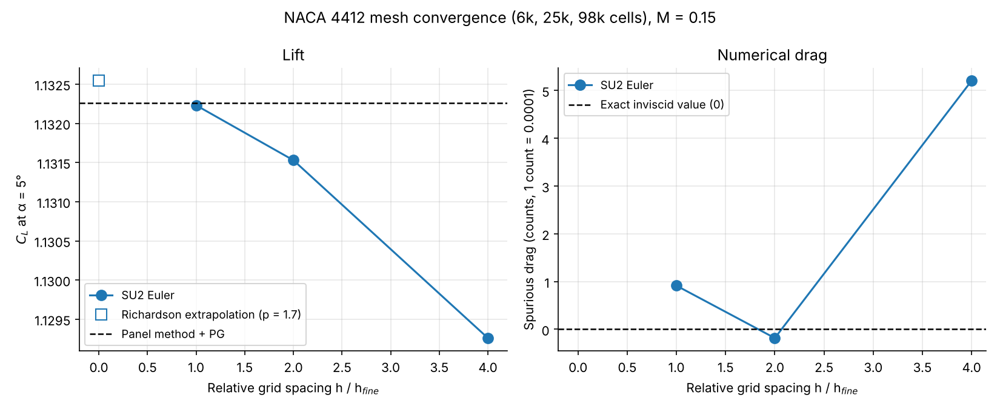
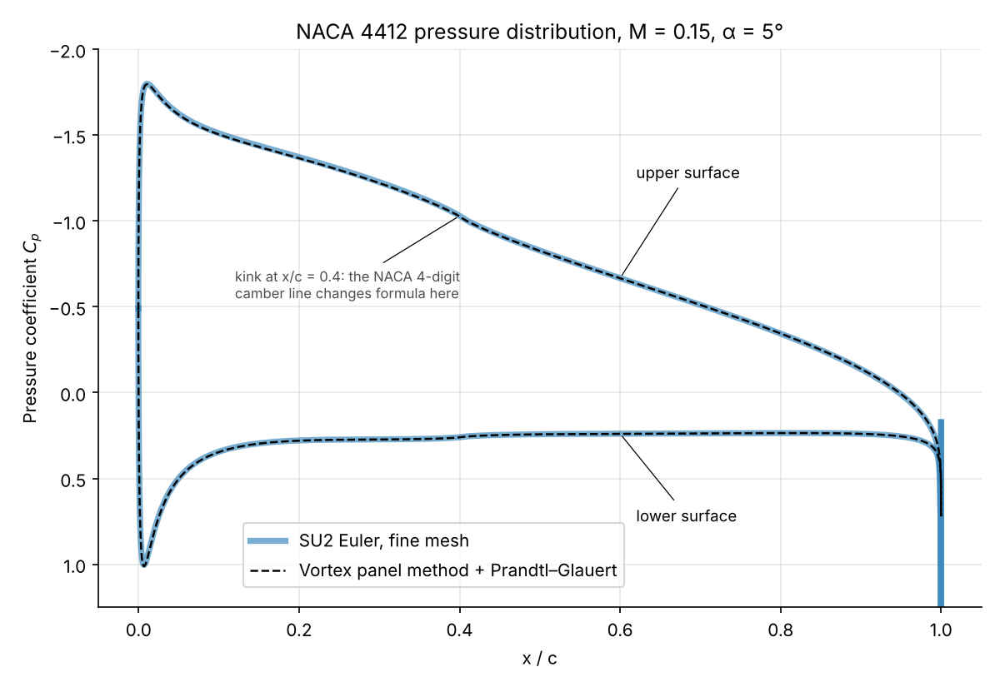
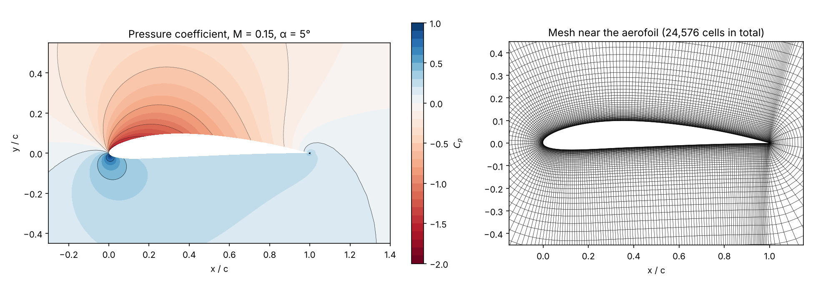
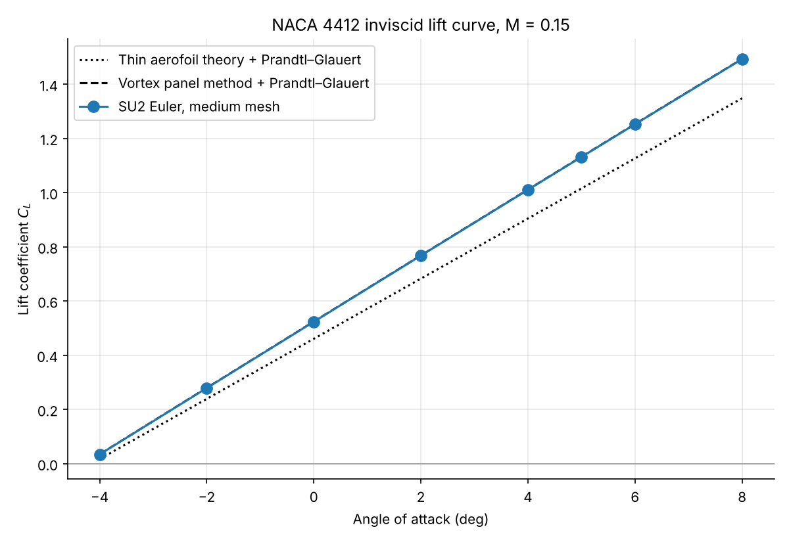

# SU2 Aerodynamics: 2D CFD Cases and Validation

An open-source CFD workflow built from scratch (SU2, Python, ParaView on WSL2 Ubuntu), with four 2D cases of increasing difficulty. Every case states what was checked against what, and how far the result can be trusted.

## Results at a glance

| Case | Physics | Status | Key result |
|---|---|---|---|
| [1. Turbulent flat plate](#1-turbulent-flat-plate-validation-against-correlations) | RANS, Spalart–Allmaras, M = 0.2, Re = 5×10⁶ per m | **Validated** | Skin friction within the spread of three standard turbulent correlations (−5.1% to +0.1% at x = 0.97 m) |
| [2. NACA 0012 lift curve](#2-naca-0012-lift-curve-validation-against-a-panel-method) | Euler, M = 0.3, α = 0–8° | **Validated** | Lift within 1% of a vortex panel method with Prandtl–Glauert correction; lift-curve slope 7.16 vs 7.23 per rad |
| [3. NACA 0012 transonic](#3-naca-0012-transonic-euler) | Euler, M = 0.8, α = 1.25° | Converged | CL = 0.3285, CD = 0.0215; upper-surface shock captured; residuals reduced by over 9 orders |
| [4. NACA 4412](#4-naca-4412-own-mesh-mesh-convergence-and-pressure-distribution) | Euler, M = 0.15, α = −4° to 8°, own mesh generator | **Validated** | Mesh-converged lift within 0.03% of a vortex panel method (Richardson-extrapolated CL = 1.1325, GCI 0.04%); lift-curve slope and zero-lift angle (−4.30°) match the panel method |

## Repository layout

```
flatplate-turbulent/   Case 1: SA flat plate, skin-friction extraction and correlations (plot_cf.py)
naca0012-liftcurve/    Case 2: angle sweep (run_sweep.sh), vortex panel method, comparison script
naca0012-transonic/    Case 3: SU2 tutorial transonic case, ParaView state file
naca4412-euler/        Case 4: mesh generator, run script, cambered panel method, analysis
    make_mesh.py         structured O-mesh generator (coarse / medium / fine family)
    run_cases.sh         mesh study + lift-curve sweep
    panel_naca4.py       vortex panel method for any NACA 4-digit section (CL, Cp, Cm)
    analyse.py           mesh convergence, Richardson extrapolation, Cp and lift-curve plots
    plot_field.py        Cp contour and mesh figure
    results/             SU2 convergence histories and surface data for every run
    analysis_output.txt  the tables printed by analyse.py
```

## 1. Turbulent flat plate: validation against correlations

**Setup:** based on SU2's turbulent flat plate test case, on the NASA Turbulence Modeling Resource 137×97 grid (plate length 2 m). Spalart–Allmaras turbulence model, adiabatic wall, converged to a density residual of 10⁻¹⁴ (`history_first_run.csv` is the full solve).

**Validation:** I extracted the wall skin friction from SU2's surface output and compared it against three standard empirical correlations for fully turbulent flat-plate flow.

| Correlation | Cf at x = 0.97 m | SU2 difference |
|---|---|---|
| Prandtl 1/5 power law | 0.00272 | +0.1% |
| Schultz-Grunow | 0.00273 | −0.1% |
| White | 0.00287 | −5.1% |
| **SU2 (SA)** | **0.00273** | |

The correlations themselves differ by about 5%, and SU2 lies within that spread.

**Checks:**
- Integrating the extracted local Cf over the plate gives 0.002859, exactly matching the solver's own integrated drag coefficient, which confirms the extraction script is reading the data correctly.
- Wall y⁺ is at most 0.48 (mean 0.40), so the first cell sits inside the viscous sublayer, as the SA model requires.


## 2. NACA 0012 lift curve: validation against a panel method

**Setup:** the NACA 0012 Euler case at M = 0.3, run at five angles of attack (0°, 2°, 4°, 6°, 8°). Each run converged automatically after 435–492 iterations, with a residual reduction of 6 orders.

**Reference:** a linear-strength vortex panel method I wrote in Python (converged to 0.1% between 100 and 400 panels), corrected for compressibility with Prandtl–Glauert.

| AoA | SU2 CL | Panel + PG | Difference |
|---|---|---|---|
| 2° | 0.2506 | 0.2531 | −1.0% |
| 4° | 0.5011 | 0.5059 | −1.0% |
| 6° | 0.7515 | 0.7581 | −0.9% |
| 8° | 1.0003 | 1.0093 | −0.9% |

The lift-curve slope is 7.16 per rad (SU2) against 7.23 per rad (panel method), a −0.9% difference, which is comparable to the accuracy of the Prandtl–Glauert correction itself. Thin aerofoil theory under-predicts by about 9% because it ignores thickness.

**Numerical drag:** inviscid, shock-free flow should produce zero drag, but SU2 reports CD up to 0.0032 at 8°, increasing with angle. This is spurious drag from the scheme's numerical dissipation, concentrated at the leading-edge suction peak, and it would reduce with mesh refinement (confirmed in case 4).


## 3. NACA 0012 transonic (Euler)

SU2's transonic NACA 0012 test case on a 10,216-cell mesh, used to verify the toolchain end to end. It converged in 896 iterations, with the density residual falling from 10⁻³·⁶ to 10⁻¹³·⁰, giving **CL = 0.3285** and **CD = 0.0215**. Because the flow is inviscid, the drag is wave drag from the shock.

The Mach contours show a supersonic pocket over the upper surface terminated by a shock at about 60% chord. On this coarse mesh the shock is smeared across several cells.


*Limitations: tutorial mesh and configuration; no mesh-convergence study.*

## 4. NACA 4412: own mesh, mesh convergence and pressure distribution

This case uses no tutorial files: the mesh, the solver set-up and the reference solution are all my own, and the result is checked for mesh independence.

**Mesh.** [`make_mesh.py`](naca4412-euler/make_mesh.py) builds a structured O-mesh by marching outward from the aerofoil surface: each layer moves along the smoothed surface normal, with a geometric growth ratio from a wall spacing of 2.4×10⁻⁴ chords. Beyond two chords the grid lines run straight out to a circular far field **100 chords** away. A fine mesh is generated first and the medium and coarse meshes are taken from it by keeping every 2nd and 4th grid line, so the three form a consistent family with a refinement ratio of exactly 2. SU2 reports all cells correctly oriented; the only highly skewed cells are the two touching the sharp trailing edge, which is unavoidable on an O-mesh.

| Mesh | Cells | Surface points | Wall spacing |
|---|---|---|---|
| Coarse | 6,144 | 128 | 1.0×10⁻³ c |
| Medium | 24,576 | 256 | 5.0×10⁻⁴ c |
| Fine | 98,304 | 512 | 2.4×10⁻⁴ c |

**Solver.** Euler equations, JST scheme, implicit time-stepping with adaptive CFL and W-cycle multigrid. Every run was taken to a density residual of 10⁻¹² (7 to 8 orders of reduction), in 1,000–2,050 iterations.

**Reference.** [`panel_naca4.py`](naca4412-euler/panel_naca4.py) extends my vortex panel method from case 2 to cambered sections and adds the surface velocity, so it gives the pressure distribution and pitching moment as well as lift. It reproduces the original code's NACA 0012 result exactly, and its pressure-integrated lift converges to its circulation lift as the panel count rises (1.1181 vs 1.1195 at 800 panels). Results are corrected to M = 0.15 with Prandtl–Glauert.

### Mesh convergence at α = 5°

| Mesh | CL | Difference from panel + PG | Cm (c/4) | CD (counts) |
|---|---|---|---|---|
| Coarse | 1.12926 | −0.27% | −0.1200 | 5.2 |
| Medium | 1.13153 | −0.06% | −0.1199 | −0.2 |
| Fine | 1.13223 | −0.003% | −0.1200 | 0.9 |
| Richardson extrapolation | 1.1325 | +0.03% | | |
| **Panel method + PG** | **1.1323** | | **−0.1201** | **0** |

- **Lift** converges monotonically with an observed order of accuracy of 1.7 (the scheme is nominally second order). The grid convergence index on the fine mesh is 0.04%, so the remaining discretisation error in CL is far smaller than any difference that would matter physically.
- **Pitching moment** varies by only 0.06% between meshes, and not monotonically, so Richardson extrapolation does not apply to it; the fine-mesh value is within 0.1% of the panel method.
- **Drag** should be exactly zero in inviscid, shock-free flow (d'Alembert's paradox). SU2's spurious drag falls from 5.2 counts on the coarse mesh to below 1 count on the medium and fine meshes, where it scatters around zero. For comparison, the tutorial NACA 0012 mesh in case 2 gave up to 32 counts.
- **Extraction check:** integrating my extracted surface Cp reproduces SU2's own CL to 5 decimal places on all three meshes, which confirms the surface ordering and the pressure recovery from SU2's conserved variables.



### Pressure distribution

The fine-mesh pressure distribution lies on top of the panel method's along both surfaces, including the suction peak (Cp ≈ −1.8) and the leading-edge stagnation point. The small kink at 40% chord is real: the NACA 4-digit camber line switches between two formulas at the point of maximum camber, so its curvature jumps there, and both methods show it. The two cells either side of the sharp trailing edge overshoot (Cp ≈ 1.8); this is a local numerical effect at the corner and is clipped from the plot.

To split the closed surface into upper and lower halves, the extraction walks the surface from the leading edge (minimum x). Splitting by the sign of y fails on a cambered section, because part of the lower surface near the leading edge lies above y = 0.





### Lift curve (medium mesh, α = −4° to 8°)

| AoA | SU2 CL | Panel + PG | Difference |
|---|---|---|---|
| −4° | 0.0342 | 0.0346 | −0.0005 |
| 0° | 0.5235 | 0.5242 | −0.0006 |
| 4° | 1.0105 | 1.0112 | −0.0007 |
| 8° | 1.4925 | 1.4933 | −0.0008 |

| | SU2 | Panel + PG | Thin aerofoil + PG |
|---|---|---|---|
| Lift-curve slope (per rad) | 6.967 | 6.969 | 6.355 |
| Zero-lift angle | −4.30° | −4.30° | −4.15° |

SU2 matches the panel method's slope to 0.03% and its zero-lift angle exactly. Differences are given in absolute terms because a percentage is misleading near CL = 0. Thin aerofoil theory captures the camber effect (the negative zero-lift angle) but under-predicts the slope by 9% because it ignores thickness, the same gap seen for the NACA 0012.



### What I learned getting here

- My first attempt used a 60×12 O-mesh with the far field only 10 chords away and CFL 1. A viscous (RANS) version diverged, and the Euler version had reduced its residual by only half an order after 200 iterations. The fix was a properly sized domain and mesh, and implicit time-stepping with multigrid.
- Explicit normal marching becomes unstable once the step is much larger than the point spacing along a layer, which on this mesh happened about 12 chords out. Marching only the near field and blending straight to a circular far field solved it.
- **A small residual is not the same as a converged answer.** With a 100-chord domain the circulation builds up slowly: in a solver-settings test, a run without multigrid reached a 10⁻⁸·⁷ residual while its CL was still nearly 9% low. Every result here is checked for a settled CL as well as a 10⁻¹² residual.

### Limitations and next steps

- These are inviscid results, so they predict more lift than a real NACA 4412 and no stall. The next step is viscous RANS (Spalart–Allmaras) on a boundary-layer-resolving C-mesh with y⁺ < 1, compared against wind-tunnel data.
- The lift-curve sweep uses the medium mesh, whose CL is 0.06% below the fine mesh at 5°. That is well inside the agreement shown above.

## Setup

- WSL2 Ubuntu, SU2 v8.5.0 (prebuilt linux64-mpi binary), ParaView 6.2.0
- Python environment: `python3 -m venv ~/cfd-env`, then `pip install numpy scipy matplotlib pandas meshio`

## Reproducing the results

```bash
# Case 1: flat plate
cd flatplate-turbulent
SU2_CFD turb_SA_flatplate.cfg      # full solve (needs mesh_flatplate_turb_137x97.su2)
SU2_CFD extract_cf.cfg             # 1 iteration from the converged solution, writes surface data
python plot_cf.py                  # comparison against correlations

# Case 2: NACA 0012 lift curve
cd naca0012-liftcurve
./run_sweep.sh && python compare_liftcurve.py

# Case 4: NACA 4412
cd naca4412-euler
python make_mesh.py                # writes the three meshes (not tracked, ~1 s to generate)
./run_cases.sh                     # 10 SU2 runs, about an hour on one core
python analyse.py                  # tables, Richardson extrapolation, plots
python plot_field.py               # Cp contour and mesh figure
```

`analyse.py` only needs the files in `results/`, so the comparison and plots can be reproduced without re-running SU2. Solver output files (`.dat`, `.vtu`, `.vtk`) are not tracked and are regenerated by running the cases.

## Author

**Sai Sidhanth Lade** — BEng Acoustical Engineering, University of Southampton  
[LinkedIn](https://www.linkedin.com/in/sai-sidhanth-lade-706869357/) · [GitHub](https://github.com/SidLade321)
