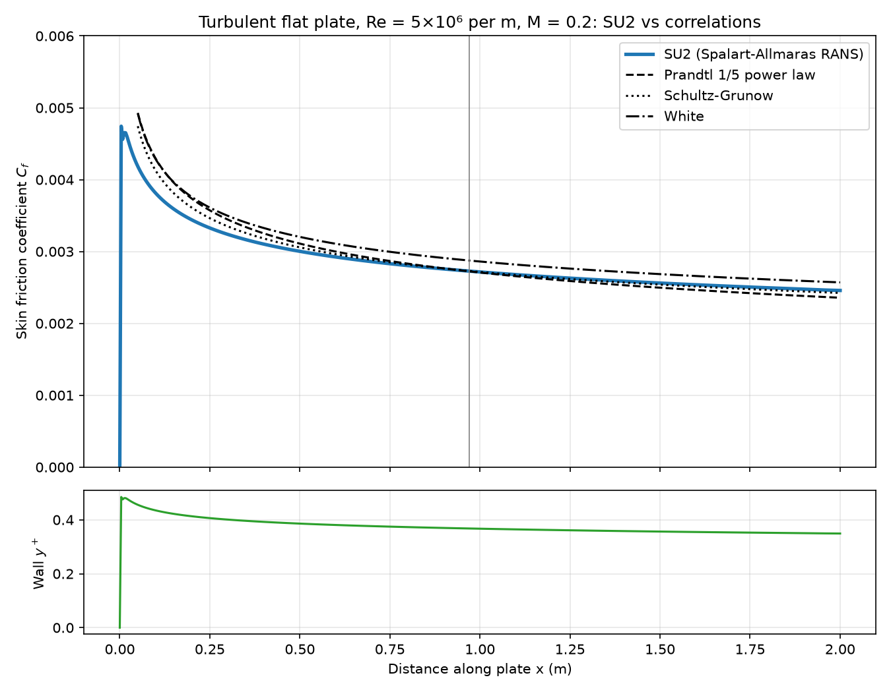
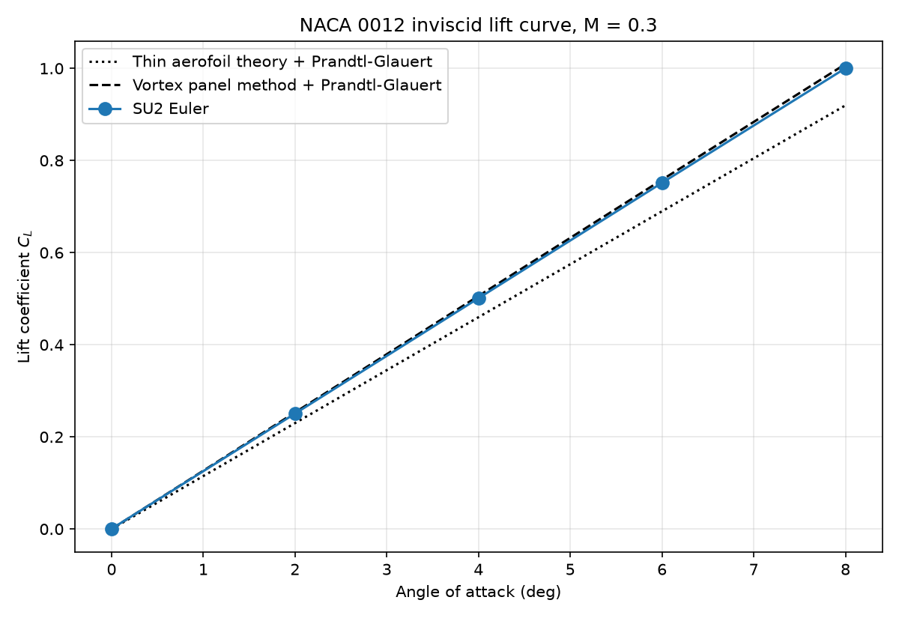
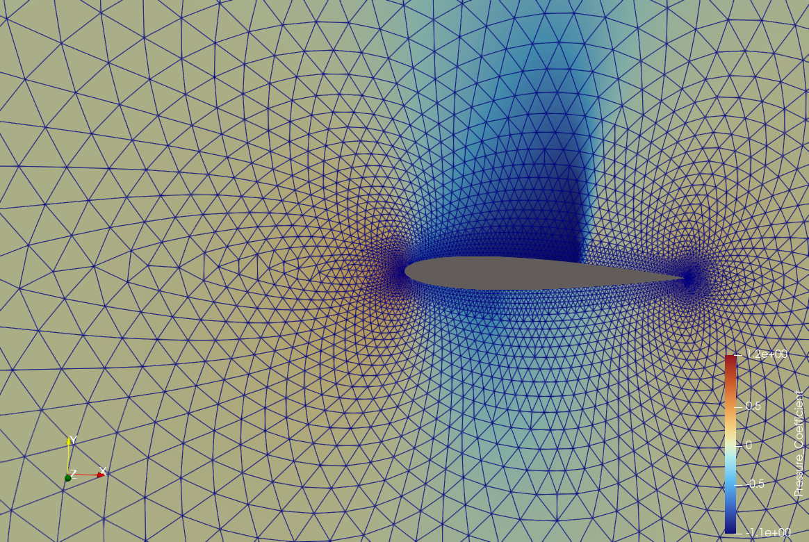

# SU2 Aerodynamics: 2D CFD Cases and Validation

An open-source CFD workflow built from scratch (SU2, Gmsh, ParaView on WSL2 Ubuntu), with three 2D cases of increasing difficulty. Each case states what was checked and how.

## Results at a glance

| Case | Physics | Status | Key result |
|---|---|---|---|
| [Turbulent flat plate](flatplate-turbulent/) | RANS, Spalart–Allmaras, M = 0.2, Re = 5×10⁶ per m | **Validated** | Skin friction within the spread of three standard turbulent correlations (−5.1% to +0.1% at x = 0.97 m) |
| [NACA 0012 lift curve](naca0012-liftcurve/) | Euler, M = 0.3, α = 0–8° | **Validated** | Lift within 1% of a vortex panel method with Prandtl–Glauert correction; lift-curve slope 7.16 vs 7.23 per rad |
| [NACA 0012](naca0012-transonic/) | Euler, M = 0.8, α = 1.25° | Converged | CL = 0.3285, CD = 0.0215; upper-surface shock captured; residuals reduced by over 9 orders |
| [NACA 4412](naca4412-euler/) | Euler, M = 0.15, α = 5°, own mesh | In progress | Scripted mesh generator and solver pipeline working; solution not yet converged |

## 1. Turbulent flat plate: validation against correlations

**Setup:** based on SU2's turbulent flat plate test case, on the NASA Turbulence Modeling Resource 137×97 grid (plate length 2 m). Spalart–Allmaras turbulence model, adiabatic wall, converged to a density residual of 10⁻¹⁴.

**Validation:** I extracted the wall skin friction from SU2's surface output and compared it against three standard empirical correlations for fully turbulent flat-plate flow.

| Correlation | Cf at x = 0.97 m | SU2 difference |
|---|---|---|
| Prandtl 1/5 power law | 0.00272 | +0.1% |
| Schultz-Grunow | 0.00273 | −0.1% |
| White | 0.00287 | −5.1% |
| **SU2 (SA)** | **0.00273** | |

The correlations themselves differ by about 5%, and SU2 lies within that spread.

**Checks:**
- Integrating the extracted local Cf over the plate gives 0.002859, exactly matching the solver's own integrated drag coefficient, which confirms the extraction script is reading the data correctly.
- Wall y⁺ is at most 0.48 (mean 0.40), so the first cell sits inside the viscous sublayer, as the SA model requires.



## NACA 0012 lift curve: validation against panel method

**Setup:** the NACA 0012 Euler case at M = 0.3, run at five angles of attack (0°, 2°, 4°, 6°, 8°). Each run converged automatically after 435–492 iterations, with a residual reduction of 6 orders.

**Reference:** a linear-strength vortex panel method I wrote in Python (converged to 0.1% between 100 and 400 panels), corrected for compressibility with Prandtl–Glauert.

| AoA | SU2 CL | Panel + PG | Difference |
|---|---|---|---|
| 2° | 0.2506 | 0.2531 | −1.0% |
| 4° | 0.5011 | 0.5059 | −1.0% |
| 6° | 0.7515 | 0.7581 | −0.9% |
| 8° | 1.0003 | 1.0093 | −0.9% |

The lift-curve slope is 7.16 per rad (SU2) against 7.23 per rad (panel method), a −0.9% difference, which is comparable to the accuracy of the Prandtl–Glauert correction itself. Thin aerofoil theory under-predicts by about 9% because it ignores thickness.

**Numerical drag:** inviscid, shock-free flow should produce zero drag, but SU2 reports CD up to 0.0032 at 8°, increasing with angle. This is spurious drag from the scheme's numerical dissipation, concentrated at the leading-edge suction peak, and it would reduce with mesh refinement.



## 2. NACA 0012 transonic (Euler)

SU2's transonic NACA 0012 test case on a 10,216-cell mesh, used to verify the toolchain end to end. It converged in 896 iterations, with the density residual falling from 10⁻³·⁶ to 10⁻¹³·⁰, giving **CL = 0.3285** and **CD = 0.0215**. Because the flow is inviscid, the drag is wave drag from the shock.

The Mach contours show a supersonic pocket over the upper surface terminated by a shock at about 60% chord. On this coarse mesh the shock is smeared across several cells.



*Limitations: tutorial mesh and configuration; no mesh-convergence study yet.*

## 3. NACA 4412 (in progress)

**Done so far:**
- Wrote a Python O-mesh generator that outputs SU2's native mesh format. I debugged a parser failure caused by an incorrect section keyword (`NELE=` instead of `NELEM=`).
- A first RANS (Spalart–Allmaras) attempt diverged (residual above 10²⁰ between iterations 196 and 587). Likely causes were skewed cells where the circular far-field maps onto the sharp trailing edge, combined with second-order reconstruction at high CFL.
- Switched to an inviscid Euler setup with the JST scheme at CFL 1.0 for stability.

**Current status:** after 200 iterations the density residual has fallen only about half an order of magnitude, so the solution is **not yet converged**, and no results are presented.

**Next steps:**
1. Run to convergence (residual reduction of at least 5 orders) and compute CL.
2. Extract upper and lower surface Cp by walking the surface from the leading edge. Splitting by the sign of y fails on a cambered section.
3. Compare against an inviscid reference (panel method), then carry out a mesh-convergence study.
4. Return to viscous RANS with a boundary-layer-resolving mesh and compare with wind-tunnel data.

## Setup

- WSL2 Ubuntu, SU2 v8.5.0 (prebuilt linux64-mpi binary), Gmsh 4.15.2 (Python API), ParaView 6.2.0
- Python environment: `python3 -m venv ~/cfd-env`, then `pip install numpy scipy matplotlib pandas gmsh meshio`

## Reproducing the flat plate validation

```bash
cd flatplate-turbulent
SU2_CFD turb_SA_flatplate.cfg      # full solve (needs mesh_flatplate_turb_137x97.su2)
SU2_CFD extract_cf.cfg             # 1 iteration from the converged solution, writes surface data
python plot_cf.py                  # comparison against correlations
```

Solver output files (`.dat`, `.vtu`, `.vtk`) are not tracked and are regenerated by running the cases.# CFD validation project
2D airfoil CFD with SU2: NACA 4412 subsonic validation, supersonic shock checks.
Setup: WSL2 Ubuntu, SU2 v8.5.0 prebuilt binary (linux64-mpi), Gmsh 4.15.2 (Python), ParaView 6.2.0.
Python env: python3 -m venv ~/cfd-env; pip install numpy scipy matplotlib pandas gmsh
## Cases
- tutorials/inviscid_naca0012: M0.8, AOA 1.25, tutorial mesh (10216 cells): CL=0.3285 CD=0.0215

## Author

**Sai Sidhanth Lade** — BEng Acoustical Engineering, University of Southampton 
[LinkedIn](https://www.linkedin.com/in/sai-sidhanth-lade-706869357/) · [GitHub](https://github.com/SidLade321)
